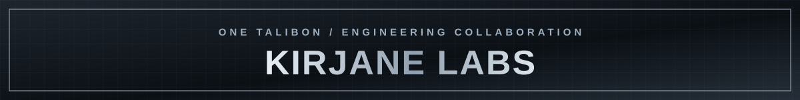
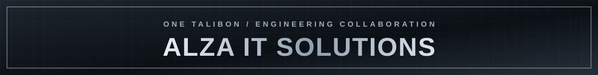

<!-- KIRION-LUCIEN / ORG-PROFILE R4 — source-controlled visuals, no invented emblem -->
<table width="100%">
<tr>
  <td width="80%" align="center" valign="middle"></td>
  <td width="20%" align="center" valign="middle"><br/><sub>PROJECT INTRA SMITHY</sub></td>
</tr>
</table>

<p align="center"><strong>ONE SYSTEM. TWO TEAMS. SHARED ENGINEERING.</strong></p>
<p align="center">
<a href="https://github.com/Project-Intra-Smithy/engineering-hub">ENGINEERING HUB</a> &nbsp;·&nbsp;
<a href="https://github.com/Project-Intra-Smithy/engineering-hub/blob/main/MASTER_INFORMATION_MAP.md">START HERE</a> &nbsp;·&nbsp;
<a href="https://github.com/Project-Intra-Smithy/engineering-hub/blob/main/PROGRAM.md">PROGRAM</a> &nbsp;·&nbsp;
<a href="https://github.com/Project-Intra-Smithy/engineering-hub/blob/main/CURRENT_STATE.md">CURRENT STATE</a>
</p>

---

## 01 / THE BUILD

**ONE TALIBON Intra-Office Portal** is a shared municipal intra-office system in development. **Project Intra Smithy** connects its engineering workspaces, contributors, decisions, and delivery evidence.

**KIRJANE LABS × ALZA IT SOLUTIONS.** Two collaborating teams, equal visibility, defined responsibilities, one system.

## 02 / THE TEAMS

Contributors to ONE TALIBON, presented under their respective organizations.

### Kirjane Labs



<table width="100%">
<tr>
  <td width="112" align="center" valign="middle"></td>
  <td valign="middle"><strong>Kirch Ivan A. Balite</strong><br/>
  <code>@Kirch-Nairu</code><br/>
  Chief Technical Officer — Kirjane Labs<br/>Tech Lead — ONE TALIBON Intra-Office System</td>
</tr>
</table>

<table width="100%">
<tr>
  <td width="112" align="center" valign="middle"></td>
  <td valign="middle"><strong>Osiris Kedigadash Palac</strong><br/>
  <code>@Syris-EkzD</code><br/>
  Development Operations (DevOps) Lead</td>
</tr>
</table>

<table width="100%">
<tr>
  <td width="112" align="center" valign="middle"></td>
  <td valign="middle"><strong>Kurt Shine Khase Halasan</strong><br/>
  <code>@k3nchinxd</code><br/>
  Development Operations (DevOps)</td>
</tr>
</table>

### ALZA IT SOLUTIONS



<table width="100%">
<tr>
  <td width="112" align="center" valign="middle"></td>
  <td valign="middle"><strong>AJ Rienze Josol</strong><br/>
  <code>@rynzz22</code><br/>
  Chief Executive Officer — ALZA IT SOLUTIONS</td>
</tr>
</table>

<table width="100%">
<tr>
  <td width="112" align="center" valign="middle"></td>
  <td valign="middle"><strong>Felicito Caturza</strong><br/>
  <code>@catzdevw</code><br/>
  Chief Operations Officer — ALZA IT SOLUTIONS</td>
</tr>
</table>

## 03 / ENGINEERING WORKSPACES

| WORKSPACE | SCOPE | ACCESS |
| :--- | :--- | :--- |
| **Engineering Hub** | Program control, work packages, decisions and reference index | [OPEN](https://github.com/Project-Intra-Smithy/engineering-hub) |
| **Backend / Domain** | Backend implementation and exact-source evidence | [OPEN](https://github.com/Project-Intra-Smithy/Talibon-Sales-Prototype) |
| **Frontend Workspace** | Interface source, contract references and validation | [OPEN](https://github.com/Project-Intra-Smithy/FRONTEND-TEAM-ONE-TALIBON-INTRA-OFFICE-WORKSPACE) |

*Some linked engineering repositories are private and require access.*

| FIND | SOURCE |
| :--- | :--- |
| Where everything is | [Master Information Map](https://github.com/Project-Intra-Smithy/engineering-hub/blob/main/MASTER_INFORMATION_MAP.md) |
| Series / capability program | [PROGRAM.md](https://github.com/Project-Intra-Smithy/engineering-hub/blob/main/PROGRAM.md) |
| Current recorded state | [CURRENT_STATE.md](https://github.com/Project-Intra-Smithy/engineering-hub/blob/main/CURRENT_STATE.md) |
| Project board design | [PROJECT_UX.md](https://github.com/Project-Intra-Smithy/engineering-hub/blob/main/PROJECT_UX.md) · [PROJECT_FIELDS.md](https://github.com/Project-Intra-Smithy/engineering-hub/blob/main/PROJECT_FIELDS.md) |
| Work-package continuity | [Issue + repository START/CLOSE protocol](https://github.com/Project-Intra-Smithy/engineering-hub/issues/63) |

## 04 / ENGINEERING STANDARD

```text
AUTHORITY → BOUNDED WORK → EXACT CANDIDATE → REVIEW → CI/QA EVIDENCE
      → TECHNICAL ACCEPTANCE → INTEGRATION → KNOWN STATE
```

**Working path:** identify the work package → verify scope and source → establish START records → implement in an approved branch → attach actual validation evidence → review → acceptance → CLOSE records.

- **Common-system-first.** Department workflows depend on validated LGU/process-owner rules.
- **Exact evidence.** Code, CI/QA results and acceptance decisions belong to their owning repositories.
- **Contracts before consumers.** The frontend does not invent backend permission or workflow behavior.
- **Technical integration.** Kirch Ivan A. Balite, ONE TALIBON Tech Lead, retains integration and acceptance responsibility.

## 05 / CURRENT STATE

For the live state of the program, use the [Engineering Hub](https://github.com/Project-Intra-Smithy/engineering-hub) and current source records. A dated document is a reference—not proof a deployment or feature is complete.

---

<p align="center"><strong>PROJECT INTRA SMITHY</strong><br/>
KIRJANE LABS <strong>×</strong> ALZA IT SOLUTIONS<br/>
<em>Engineered together. Governed by evidence.</em></p>

<p align="center"><sub>DESIGN &amp; VISUAL ENGINEERING / KIRION-LUCIEN</sub></p>
