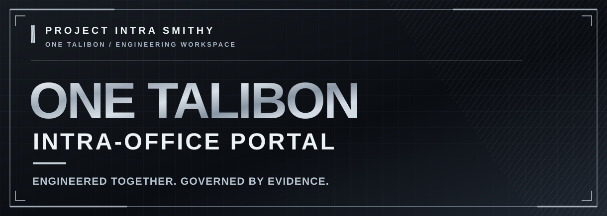

<p align="center"><strong>THE ENGINEERING HEADQUARTERS FOR ONE TALIBON</strong></p>

<p align="center">A common-system-first engineering program, delivered through clear ownership, bounded execution, verifiable evidence, and human technical acceptance.</p>

<p align="center">
  <a href="https://github.com/Project-Intra-Smithy/engineering-hub">Engineering Hub</a> ·
  <a href="https://github.com/Project-Intra-Smithy/engineering-hub/blob/main/MASTER_INFORMATION_MAP.md">Master Information Map</a> ·
  <a href="https://github.com/Project-Intra-Smithy/engineering-hub/blob/main/PROGRAM.md">Program Board</a> ·
  <a href="https://github.com/Project-Intra-Smithy/engineering-hub/blob/main/CURRENT_STATE.md">Current State</a>
</p>

---

## 01 / The mission

**Project Intra Smithy** is the engineering control organization for the **ONE TALIBON Intra-Office System**. It coordinates work packages, source repositories, technical handoffs, dependencies, validation evidence, decisions, and the acceptance path for an integrated municipal intra-office platform.

This is an engineering headquarters, **not** a claim that every planned capability is implemented, integrated, or production-ready. Product repositories remain authoritative for their own executable source and exact validation evidence.

> **Operating principle:** Move forward through verified engineering states. Do not substitute presentation, project-board labels, or unvalidated assumptions for working software and evidence.

## 02 / Collaborative engineering force

<table>
  <tr>
    <th align="center" width="50%">KIRJANE LABS</th>
    <th align="center" width="50%">ALZA IT SOLUTIONS</th>
  </tr>
  <tr>
    <td align="center">Engineering and technical delivery</td>
    <td align="center">Engineering and project collaboration</td>
  </tr>
</table>

**KIRJANE LABS × ALZA IT SOLUTIONS** collaborate on building the **ONE TALIBON Intra-Office Portal**. Both organizations are presented as a shared delivery force while each contributor's stated responsibility remains distinct.

Project Intra Smithy provides the engineering control surface; that collaboration does not supersede the system's human technical authority or the source-of-truth rules of its repositories.

### Human technical leadership

**Kirch Ivan A. Balite** `@Kirch-Nairu`  
**Tech Lead — ONE TALIBON Intra-Office System**  
**Chief Technical Officer — Kirjane Labs**

Kirch holds responsibility for the program's technical direction, architecture, integration, and final technical acceptance. The Engineering Hub organizes that authority; it does not replace it.

### Supporting project & technical contributors

| Organization | Contributor | Position | GitHub identity |
| :--- | :--- | :--- | :--- |
| **ALZA IT SOLUTIONS** | **AJ Rienze Josol** | Chief Executive Officer | `@rynzz22` · AJ RIENZE |
| **ALZA IT SOLUTIONS** | **Felicito Caturza** | Chief Operations Officer | `@catzdevw` · catz dev |
| **KIRJANE LABS** | **Osiris Kedigadash Palac** | Development Operations (DevOps) Lead | `@Syris-EkzD` |
| **KIRJANE LABS** | **Kurt Shine Khase Halasan** | Development Operations (DevOps) | `@k3nchinxd` · Shakoy Pandesal w/ kiss nani |

Names and roles above represent the project's supplied contributor registry. GitHub handles are shown as identifiers rather than unverified outbound profile links.

## 03 / Engineering control plane

```text
AUTHORITY
    │
    ▼
BOUNDED WORK
    │
    ▼
EXACT CANDIDATE
    │
    ▼
REVIEW
    │
    ▼
CI / QA EVIDENCE
    │
    ▼
TECHNICAL ACCEPTANCE
    │
    ▼
INTEGRATION
    │
    ▼
KNOWN STATE
```

`Authority -> Bounded Work -> Exact Candidate -> Review -> CI/QA Evidence -> Technical Acceptance -> Integration -> Known State`

**A branch is not an accepted change.** A passing job is not full product validation. A reviewed candidate is not automatically integrated. Each transition must be grounded in the owning repository's current instructions, exact source, and recorded evidence.

## 04 / Engineering headquarters — where to go

> **Access note:** Several work repositories and Engineering Hub documents are private. Links below are intended for authorized contributors; public GitHub visitors may be unable to open them.

| Destination | Purpose | Start here |
| :--- | :--- | :--- |
| **Engineering Hub** | Program control, source-of-truth routing, decisions, work packages, and engineering state | [Open hub](https://github.com/Project-Intra-Smithy/engineering-hub) |
| **Master Information Map** | Canonical starting index for finding the right engineering record | [Read index](https://github.com/Project-Intra-Smithy/engineering-hub/blob/main/MASTER_INFORMATION_MAP.md) |
| **Program / Series Board** | Capability roadmap and work-package structure | [Read program](https://github.com/Project-Intra-Smithy/engineering-hub/blob/main/PROGRAM.md) |
| **Current State** | Dated snapshot; reconcile against live GitHub records | [Read state](https://github.com/Project-Intra-Smithy/engineering-hub/blob/main/CURRENT_STATE.md) |
| **Project UX and Fields** | Control-board layout and field conventions | [Project UX](https://github.com/Project-Intra-Smithy/engineering-hub/blob/main/PROJECT_UX.md) · [Fields](https://github.com/Project-Intra-Smithy/engineering-hub/blob/main/PROJECT_FIELDS.md) |
| **Backend / Domain Workspace** | Backend source and work-package implementation; resolve the current authoritative state before coding | [Product work tree](https://github.com/Project-Intra-Smithy/Talibon-Sales-Prototype) |
| **Frontend Team Workspace** | Laravel/Inertia/React frontend development, integration contracts, and validation references | [Frontend workspace](https://github.com/Project-Intra-Smithy/FRONTEND-TEAM-ONE-TALIBON-INTRA-OFFICE-WORKSPACE) |

**Truth is distributed intentionally:** the Engineering Hub indexes and controls the program; executable repositories own source and runtime evidence; LGU/process owners own municipal workflow truth; Kirch owns final technical integration and acceptance.

## 05 / Contributor onboarding

Authorized contributors should follow this sequence before treating work as active:

1. **Locate the work.** Start with the [Master Information Map](https://github.com/Project-Intra-Smithy/engineering-hub/blob/main/MASTER_INFORMATION_MAP.md), owning issue, program state, and responsible repository.
2. **Resolve authority and scope.** Confirm the work-package owner, boundaries, dependencies, current decision, and exact live source SHA. Do not restart a historical branch simply because it exists.
3. **Establish continuity.** Follow the [paired issue and repository-memory START/CLOSE protocol](https://github.com/Project-Intra-Smithy/engineering-hub/issues/63) wherever required by the owning repository. Missing paired records require reconciliation.
4. **Implement within the lane.** Work on an authorized, appropriately scoped branch. Preserve provenance, human credit, backend contracts, and architecture invariants.
5. **Produce real evidence.** Provide reproducible build/test commands, logs, changed files, exact candidate commit, known failures, and any required browser or integration results.
6. **Request review and closure.** Record the outcome and remaining work. Only the relevant human authority can grant technical acceptance and integration.

If instructions conflict, **stop the affected change and escalate the contradiction** rather than inventing a resolution.

## 06 / Validation and technical acceptance

| Gate | Minimum question |
| :--- | :--- |
| **Scope** | Does the candidate implement only its authorized work package? |
| **Source** | Is the exact branch, base, candidate SHA, and changed-file inventory known? |
| **Contracts** | Does it preserve the owning system's documented domain and integration boundaries? |
| **Review** | Were material defects and negative cases actually examined? |
| **CI / QA** | Are pass/fail outcomes backed by executed checks and attributable evidence? |
| **Acceptance** | Has the proper technical authority made an explicit decision? |
| **Integration** | Is the merged or released state separately verified and recorded? |

No decorative status badge should imply certification, production release, or successful validation without supporting evidence.

## 07 / Architecture and governance invariants

- **Common-system-first:** reusable shared system capabilities precede speculative department-specific workflows.
- **Municipal process truth:** department routing, approval chains, confidentiality, signing authority, SLAs, and other LGU-specific rules require validated process-owner authority.
- **Distinct domains stay distinct:** Task is not Work Request; Work Request is not Correspondence; Document is not Transaction; Meeting is not Task.
- **Contracts before consumers:** frontend work consumes released backend behavior and does not invent authorization or workflow semantics.
- **Evidence over assertion:** demos, synthetic UI states, and passing asset builds are not proof of production readiness.
- **Accountability remains human:** program tooling and engineering coordination support Kirch's Technical Authority; they do not replace it.

## 08 / Find the current state, not an old promise

For active tasks, decisions, and acceptance outcomes, start with the [Engineering Hub](https://github.com/Project-Intra-Smithy/engineering-hub), its [current-state documents](https://github.com/Project-Intra-Smithy/engineering-hub/blob/main/CURRENT_STATE.md), and the relevant owning issue. Dated files may be historical snapshots: **reverify live GitHub state before acting.**

---

<p align="center">
  <strong>PROJECT INTRA SMITHY</strong><br/>
  <strong>ONE TALIBON · INTRA-OFFICE SYSTEM</strong><br/>
  <em>Engineered together. Governed by evidence.</em><br/>
  <strong>KIRJANE LABS × ALZA IT SOLUTIONS</strong>
</p>
